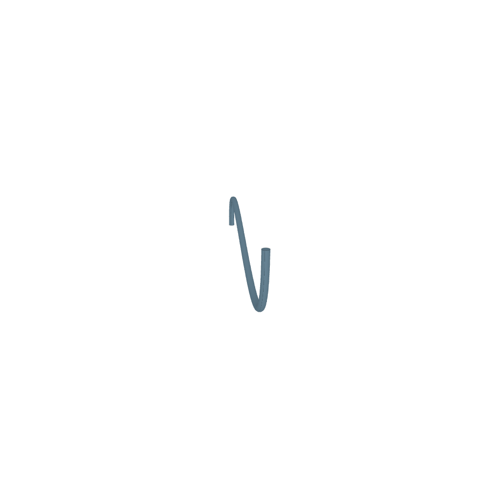

###### Note: Do not edit this file directly, it is automatically generated from the CAD model

# Wire_Between_Points

## Inputs

- **Start Shape** (geometry)
- **End Shape** (geometry)
- **Stiffness** (number)
- **Flip Start** (boolean)
- **Flip End** (boolean)

 

